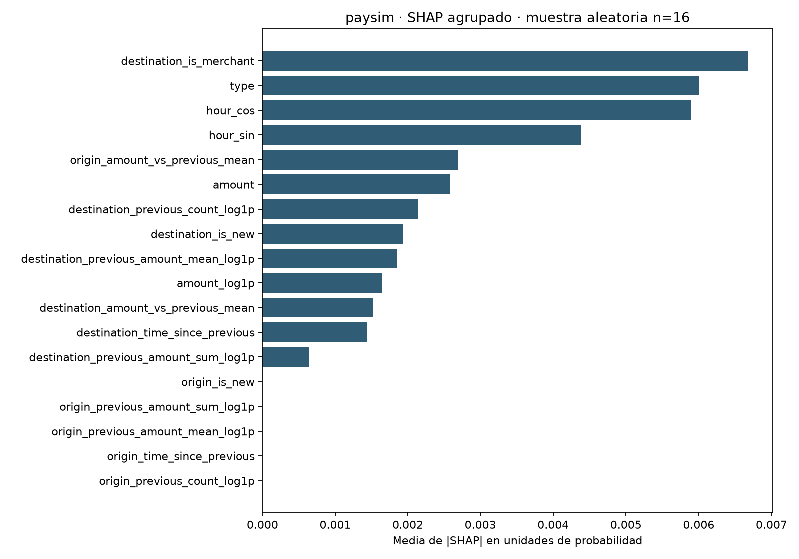
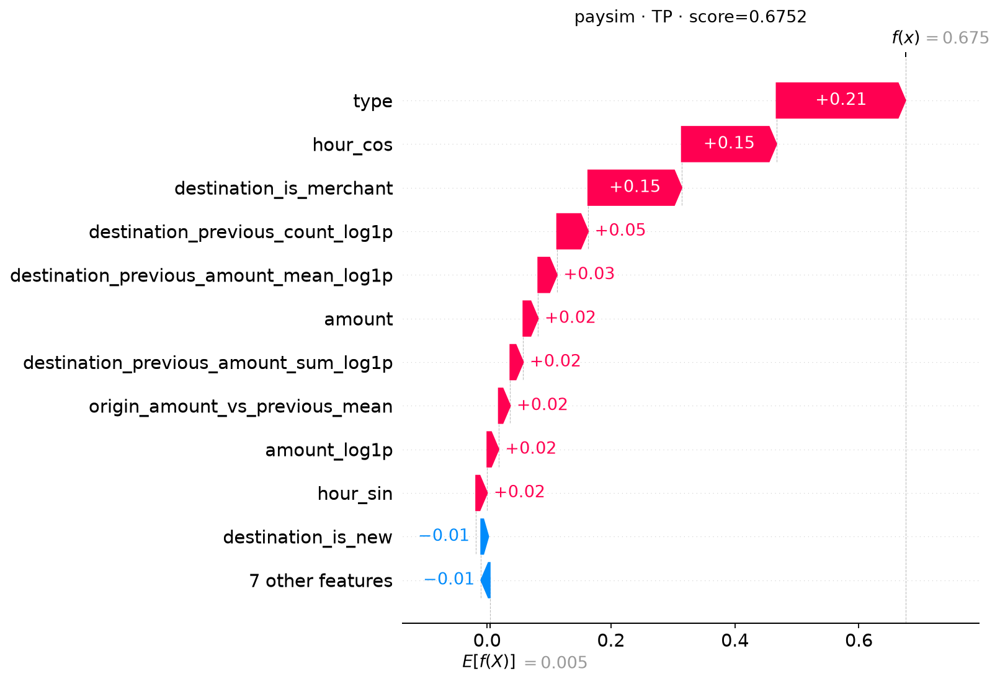
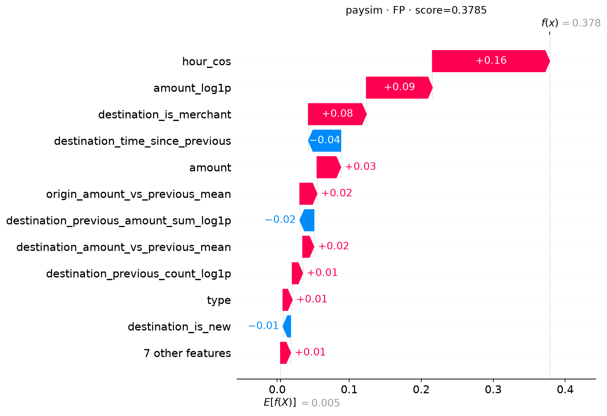
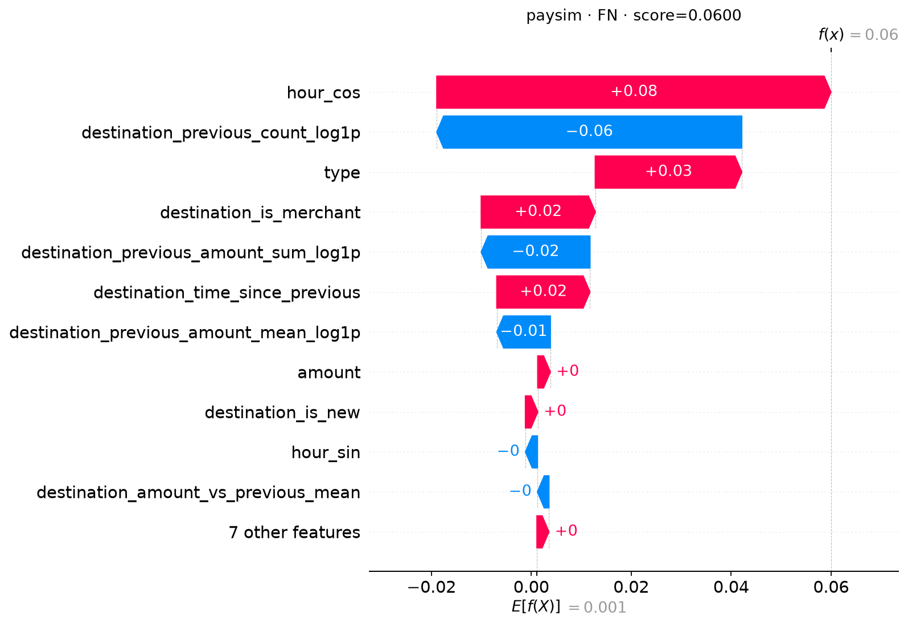
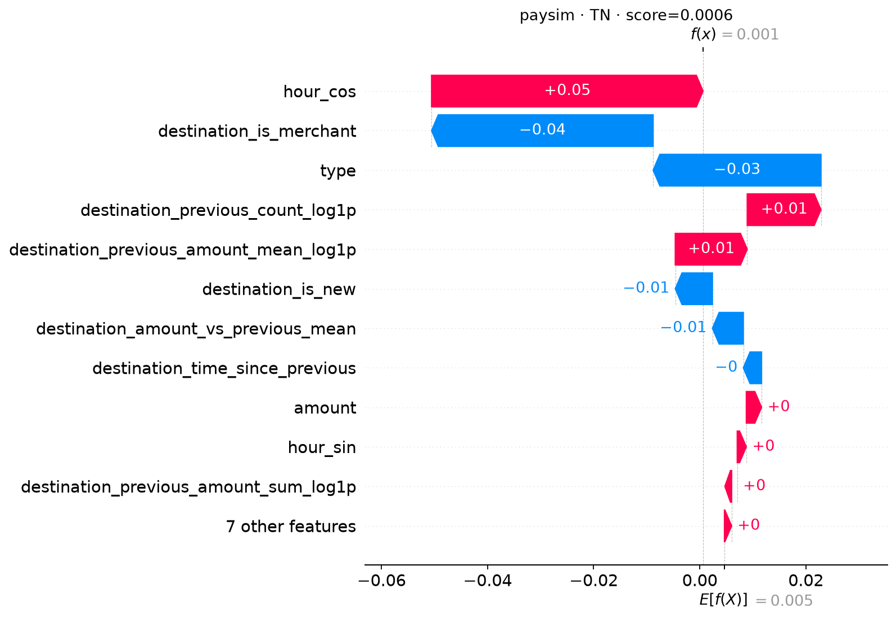

# Explicabilidad del híbrido

Grouped transformed target attributes through the actual hybrid, conditional on fixed past features and graph. Not edge, neighbor-feature, causal or raw-unit attribution.

Mean absolute SHAP on 16 uniformly sampled test transactions, not the whole population. Illustrative TP/FP/FN/TN extras excluded from global aggregation.

Fondo: 8 filas de train. Permutaciones: 3. Error máximo de aditividad: 2.9802322e-08.

## Caso TP

## Caso FP

## Caso FN

## Caso TN

La contribución indica sensibilidad del modelo bajo este juego de perturbación, no causalidad ni justificación humana del fraude. Las aproximaciones dependen del fondo y del número de permutaciones.
